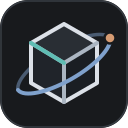

<p align="center"></p>

# 科学与工程可视化 · Visualization of Science and Engineering

用交互模型、动画、字幕和对照实验，把科学与工程中的结构、因果关系和工作过程讲清楚。项目由 **CZL-Homelab** 组织维护，欢迎开发者、内容作者和 AI 辅助贡献。

- **唯一主仓库**：[CZL-Homelab/Visualization-of-Science-and-Engineering](https://github.com/CZL-Homelab/Visualization-of-Science-and-Engineering)
- **网站入口**：[组织 GitHub Pages](https://czl-homelab.github.io/Visualization-of-Science-and-Engineering/)
- **当前项目**：[Motor Lab 电机原理实验室](https://czl-homelab.github.io/Visualization-of-Science-and-Engineering/motor-lab/) · [Stock Market Lab 股票市场原理实验室](https://czl-homelab.github.io/Visualization-of-Science-and-Engineering/stock-market-lab/) · [Desalination Lab 海水淡化原理实验室](https://czl-homelab.github.io/Visualization-of-Science-and-Engineering/desalination-lab/) · [Fusion Lab 核聚变反应堆实验室](https://czl-homelab.github.io/Visualization-of-Science-and-Engineering/fusion-lab/)
- **开始贡献**：[CONTRIBUTING.md](CONTRIBUTING.md) · **AI 工作约定**：[AGENTS.md](AGENTS.md) · **交接与发布状态**：[docs/HANDOFF.md](docs/HANDOFF.md)

后续代码、Issue、PR 和部署均以组织仓库为准。个人账号下的历史仓库和旧站点不是后续同步或发布目标。

## 当前演示 / Current projects

以下为本分支实现的四个实验室；正式站点以已合并的 `main` 和成功的 Pages 部署为准。未发布变更见 [CHANGELOG.md](CHANGELOG.md)，分支、PR 与待办见 [交接记录](docs/HANDOFF.md)。

| 项目 | 内容 | 源码与说明 |
| --- | --- | --- |
| Motor Lab | 六类电机，精细三维分解，48 幕课程，自动运镜字幕，四组双模型对比 | [Projects/motor-lab](Projects/motor-lab) |
| Stock Market Lab | 10 个模块、60+ 幕讲解：K 线与周期聚合、成交量与技术指标、订单簿撮合、A 股/美股制度、IPO、估值、杠杆、ETF 与 10 组同步对比 | [Projects/stock-market-lab](Projects/stock-market-lab) |
| Desalination Lab | 7 个模块、25 幕讲解、3 个 WebGL 3D 视图：含盐阶梯、渗透压与 273 米水柱、单段 RO 质量守恒、MSF 闪蒸瀑布、膜污染曲线、能耗口径与整厂浓盐水 | [Projects/desalination-lab](Projects/desalination-lab) |
| Fusion Lab | 7 章、42 幕讲解：ITER 三维解剖、磁约束（含仿星器）、一次放电、氚燃料循环与电站功率账本 | [Projects/fusion-lab](Projects/fusion-lab) |

Motor Lab 默认先展示运行动画，再进入逐步讲解。它支持单文件离线运行；可选系统语音及外部参考资料的联网需求见项目说明。几何、场线和工作点属于教学模型，具体边界见各项目文档。

Stock Market Lab 面向没有金融基础的学习者：从一根 K 线的四个价格出发，逐层拆到订单簿、一级/二级市场资金流、IPO 摊薄、估值、杠杆强平与 ETF 分散。所有行情与收益都是标注过的模拟数据或固定种子模型；规则页记录核对日期与官方来源，不构成投资建议。

Desalination Lab 面向工程与环保兴趣的学习者：从含盐阶梯到渗透压（≈27 bar、273 米水柱），再到可手调的单段 RO（质量守恒与能耗联动）、MSF 闪蒸瀑布、膜污染曲线、统一口径的能耗对比与整厂浓盐水平衡。B/C/G 三个模块提供可拖拽的 WebGL 3D 视图（渗透装置、卷式膜元件、厂区巡览），默认进入带标注、暂停与镜头控制的 3D，保留 2D 剖面切换。所有模型为教学近似并标注边界；物理不变量由 `tests/check-physics.cjs` 锁定，文献数值标注核对日期与来源。

Fusion Lab 核聚变反应堆实验室提供 7 章、42 幕讲解：氘氚反应、磁约束（含仿星器）、ITER 三维解剖、放电脉冲、功率平衡、氚循环与电站。所有运行资源内嵌，模型为教学近似。源码、构建与验证见 [Projects/fusion-lab](Projects/fusion-lab)。

Fusion Lab adds seven chapters and 42 scenes covering D–T fusion, confinement (including a stellarator scene), ITER anatomy, pulse operation, power accounting, tritium inventories and power plants. All runtime assets are embedded; the models are educational approximations. See [the project README](Projects/fusion-lab/README.md) for build commands and limitations.

## 入场体验 / Entrance experience

目录与四个 Lab 都有统一的轻量入场：结构框架、电机转子、市场图表、膜分离或磁约束图形，约 1.6 秒自动结束。可点击“跳过入场”，或开始鼠标/键盘操作立即进入；顶栏主题按钮旁可回放。直接打开带锚点的链接会跳过入场，不锁定滚动、不自动播放语音，也不显示虚构加载进度。

开启系统“减少动态效果”会直接显示页面、禁用入场回放；运行中改变该偏好同样有效。离线下载后重新打开会清理旧的入场节点与按钮，避免重复。Logo 保留空间框架与前后穿越的轨道，以石墨灰白为主，少量青、蓝和铜色点缀；16–32px 下减少次要细节。

## 主题与实验室导航 / Theme and lab navigation

根目录页与各实验室共用同一套主题偏好。页面在首次绘制前读取 `czl-lab-theme`；没有记录时跟随系统 `prefers-color-scheme`，右上角按钮切换后写回 `localStorage`，并把 `meta[name="theme-color"]` 同步为当前背景。未手动选择时跟随系统实时变化，选择后保持用户偏好；页脚“主题：跟随系统”可清除手动选择。同源页面同步切换；禁用存储时仍能按系统初始化并在当前页面手动切换。这里的浅色/暗黑取决于系统偏好，不按白天/夜晚时钟强制切换。两套主题都内联在单文件页面中，不请求远程样式或字体，断网、直接打开 `index.html` 仍然有效。

各实验室的顶栏左侧都有返回 `Lab Projects` 目录的入口；页脚前有“换一个实验室 / Lab projects”目录，列出全部实验室、标记当前页，并提供返回根目录的链接。目录使用相对路径，`/motor-lab/`、`/stock-market-lab/`、`/desalination-lab/`、`/fusion-lab/` 与 `_site` 的本地 `file://` 预览都能解析；单独复制某个 `index.html` 时需保留同样的站点目录结构。新增实验室时必须同时更新全部既有实验室的目录与 `site/projects.json`。

各实验室在滚动后右下角提供“↑ 顶部”按钮；主题按钮是真实的 `<button>`，带有可读名称与 `aria-pressed` 状态；切换不重载页面，也不应出现主题闪烁。深色与浅色下都要检查正文对比度、图表网格、焦点环与 390px 窄屏。主题与导航的实现约定见 [AGENTS.md](AGENTS.md)，提交流程见 [CONTRIBUTING.md](CONTRIBUTING.md)。

## 快速开始

需要 Git、Python 3.9+ 和 Node.js 22 LTS。当前项目不需要 npm 安装或 Python 第三方包。

以下命令在包含四个实验室的本分支或合并后的 `main` 上，从仓库根目录执行。新克隆默认得到 `main`；如参与尚未合并的工作，先按对应 PR 检出其分支，避免把未发布内容当作已上线版本。

```sh
git clone https://github.com/CZL-Homelab/Visualization-of-Science-and-Engineering.git
cd Visualization-of-Science-and-Engineering
# 构建当前分支的四个实验室，再检查并打包整个站点
for lab in motor-lab stock-market-lab desalination-lab fusion-lab; do
  python "Projects/$lab/build.py" || exit 1
done
python scripts/check_site.py
python -m http.server 8767 --bind 127.0.0.1 --directory _site
```

打开 `http://127.0.0.1:8767/` 查看完整目录及四条项目路由；停止服务使用 Ctrl+C。也可直接打开 `_site/index.html`，并保留目录结构以使用跨 Lab 导航。单独进入某个 `Projects/<slug>/` 启动 HTTP 服务时，访问服务器根地址 `/`。Linux/macOS 若没有 `python` 命令，可使用 `python3`；上述循环可在 Bash 或 Git Bash 中执行。

修改某个实验室后，按其 README 构建、对所有源码执行 `node --check`，再运行对应检查：

| 项目目录 | Node 检查（在该项目目录执行） |
| --- | --- |
| `Projects/motor-lab/` | `node tests/check-model.cjs` |
| `Projects/stock-market-lab/` | `node tests/check-finance.cjs`、`node tests/check-build.cjs` |
| `Projects/desalination-lab/` | `node tests/check-physics.cjs`、`node tests/check-scenes.cjs`、`node tests/check-build.cjs` |
| `Projects/fusion-lab/` | `node tests/check-physics.cjs`、`node tests/check-build.cjs` |

公共标识、主题或入场改动还须运行 `node scripts/check-theme.cjs`，重新构建受影响的 Lab 并检查目录与各 Lab 的深浅主题、窄屏、跳过/回放和减少动态效果。公共资源由 `scripts/shared_experience.py` 在构建时内嵌，源码见 `assets/theme.js`、`assets/entry.js`、`assets/entry.css`。

仅修改文档时核对相关链接、路径和命令，并运行 `git diff --check`；无需为说明文字重复无关的模型或 UI 测试。

已有本地工程可确认并更新远程：

```sh
git remote -v
git remote set-url origin https://github.com/CZL-Homelab/Visualization-of-Science-and-Engineering.git
git fetch origin
```

请先检查工作区和分支历史，再同步代码；不要使用强推或覆盖他人的未提交改动。

## 仓库结构

```text
.github/                 CI、Pages 发布、Issue 与 PR 模板
assets/                  SVG 标识、共享插图、主题与入场 JS/CSS
site/                    目录模板与项目清单
scripts/                 目录构建、共享资源内嵌、主题行为及链接检查
AGENTS.md                仓库级 AI 工作约定
CONTRIBUTING.md          开发、验证与协作流程
CHANGELOG.md             面向使用者的更新记录，区分未发布变更
docs/HANDOFF.md          当前分支、验证、PR/发布状态及下一步
Projects/
  motor-lab/
    AGENTS.md            电机模型和状态管理的专门约定
    src/                 应修改的页面、样式和脚本源码
    vendor/              固定版本依赖及其许可证
    tests/               物理关系与离线封装检查
    build.py             将源码组装为单文件网页
    index.html           生成的离线交付文件，随源码一起提交
  stock-market-lab/
    AGENTS.md            金融模型、规则版本与教学边界约定
    src/                 页面、样式、共享计算引擎与 10 个模块
    tests/               金融不变量与离线封装检查
    build.py             将源码组装为单文件网页
    index.html           生成的离线交付文件，随源码一起提交
  desalination-lab/
    AGENTS.md            渗透、RO、整厂流程与 3D 维护约定
    src/                 物理模型、页面、图表与 7 个模块
    vendor/              离线 Three.js 及其许可证
    tests/               物理、场景联动与离线封装检查
    build.py             将源码组装为单文件网页
    index.html           生成的离线交付文件，随源码一起提交
  fusion-lab/
    AGENTS.md            核聚变模型、三维验证与协作约定
    src/                 物理模型、教学内容与三维场景
    vendor/              离线 Three.js 及其许可证
    tests/               物理守恒、几何及离线封装检查
    build.py             将源码组装为单文件网页
    index.html           生成的离线交付文件，随源码一起提交
```

请修改 `src/`，再重新生成 `index.html`。不要只编辑生成页。新增演示放在 `Projects/<slug>/`，提供独立说明、构建和检查方式，并在 `site/projects.json` 登记项目；构建器据此生成目录和对应路由。若项目需要额外资源，请同时扩展打包逻辑。

## 协作与发布

日常开发使用功能分支和 PR；PR 会执行独立 CI。合并到组织仓库的 `main` 后，符合 `.github/workflows/pages.yml` 路径过滤的变更会触发构建、验证和部署，也支持从 Actions 手动运行。README、AGENTS、贡献指南及发布配置在当前过滤范围内；其他文档修改不一定触发发布。

站点位于 `czl-homelab.github.io/Visualization-of-Science-and-Engineering/`，不是组织根域的独立首页仓库。站点根路径是可搜索的项目目录，四条项目路由为 `/motor-lab/`、`/stock-market-lab/`、`/desalination-lab/`、`/fusion-lab/`。发布仅上传生成的网页，不上传源码、备份或工作文件。

仓库管理员应将 **Settings → Pages → Source** 设为 **GitHub Actions**。新维护者可在 [Actions](https://github.com/CZL-Homelab/Visualization-of-Science-and-Engineering/actions) 查看检查和部署记录。现有流程使用仓库提供的 `GITHUB_TOKEN`，不需要在源码中保存个人令牌。

MIT 许可见 [LICENSE](LICENSE)。第三方依赖保留各自许可证，例如 [Three.js MIT 许可](Projects/motor-lab/vendor/THREE-LICENSE.txt)。现有作者署名保持不变。

## 文档维护与交接 / Documentation and handoff

功能和维护流程变更须在同一 PR 更新相关 README、指南、AGENTS.md 和更新记录；具体要求见 [AI 协作约定](AGENTS.md) 与 [贡献指南](CONTRIBUTING.md)。[docs/HANDOFF.md](docs/HANDOFF.md) 汇总当前工作、实际验证、未发布状态和下一步，后续维护者或 AI 应先阅读并在交付时更新。

## 目录与视觉标识 / Directory and visual identity

根地址是项目总目录，后续演示统一登记在 `site/projects.json`，不再用某一个演示代替首页。构建目录：先构建各演示，再在仓库根目录运行 `python scripts/check_site.py`；本地预览使用 `python -m http.server 8767 --bind 127.0.0.1 --directory _site`。

SVG 标识位于 [`assets/icon.svg`](assets/icon.svg)：空间框架表示结构，轨迹表示科学观察和运动。README、目录及所有实验室使用同一标识；各实验室内嵌 SVG，保持离线使用。网站头部和页脚提供完整仓库入口。图标与复用说明见 [`assets/README.md`](assets/README.md)。

## English

### Purpose and canonical home

An open collection of interactive science and engineering explanations maintained by **CZL-Homelab**. Explore structures, causal relationships and working principles through models, animation, captions and comparisons.

- Canonical repository: [CZL-Homelab/Visualization-of-Science-and-Engineering](https://github.com/CZL-Homelab/Visualization-of-Science-and-Engineering).
- Project directory: [GitHub Pages](https://czl-homelab.github.io/Visualization-of-Science-and-Engineering/).
- This branch contains four labs: [Motor Lab](Projects/motor-lab/README.md) (six motor types), [Stock Market Lab](Projects/stock-market-lab/README.md) (ten modules), [Desalination Lab](Projects/desalination-lab/README.md) (seven modules and three annotated 3D views), and [Fusion Lab](Projects/fusion-lab/README.md) (seven chapters and 41 scenes). Production reflects merged `main` and a successful Pages deployment, not an open PR. See [CHANGELOG.md](CHANGELOG.md) for unreleased changes and [docs/HANDOFF.md](docs/HANDOFF.md) for current work and release status.
- Read [CONTRIBUTING.md](CONTRIBUTING.md) and the applicable [AGENTS.md](AGENTS.md) before contributing. Personal historical repositories and sites are not synchronization or deployment targets.

### Entrance experience

The catalog and all four labs have a short, subject-specific entrance: structural frame, rotor, market chart, membrane separation or magnetic confinement. It finishes in about 1.6 seconds; skip it immediately or begin pointer/keyboard interaction, and replay from the header. Anchored deep links open directly. There is no scroll lock, speech autoplay or fabricated loading progress. Reduced motion bypasses the entrance and disables replay, including runtime preference changes. Reopened offline downloads clean up captured entrance nodes/controls. The refined logo uses a graphite/gray-white frame, a depth-ordered orbit and restrained cyan/blue/copper accents, with fewer details at 16–32px.

### Theme and lab navigation

The catalog and all labs share one theme preference. Each page reads `czl-lab-theme` before first paint, falls back to `prefers-color-scheme`, persists explicit choices in `localStorage`, and updates `meta[name="theme-color"]`. Without an explicit choice, live system changes are followed; a manual choice takes priority. The footer system-theme button restores automatic mode. Same-origin pages synchronize, and blocked storage still permits system initialization and an in-memory choice. Light/dark is not forced by a day/night clock. Both palettes are inlined in the standalone files; no remote styles or fonts are requested, so the pages keep working offline.

Each lab header starts with a link back to the `Lab Projects` catalog. Before the footer, a "Lab projects" directory lists every lab, marks the current page, and links back to the catalog. Relative paths keep `/motor-lab/`, `/stock-market-lab/`, `/desalination-lab/`, `/fusion-lab/` and `file://` previews working. Labs also show a floating “top” button after scrolling. A new lab must update every lab directory and `site/projects.json`.

The theme control is a real `<button>` with an accessible name and `aria-pressed`; switching must not reload the page or flash the wrong palette. Check contrast, chart grids, focus rings and narrow layouts in both themes. See [AGENTS.md](AGENTS.md) for implementation rules and [CONTRIBUTING.md](CONTRIBUTING.md) for the review flow.

### Run and build

Use Git, Python 3.9+ and Node.js 22 LTS. No npm installation or third-party Python packages are needed. The Chinese quick-start commands above build all four labs from the repository root, run `python scripts/check_site.py`, and serve `_site` at `http://127.0.0.1:8767/`. Use Bash/Git Bash for the loop and `python3` where appropriate. A fresh clone starts on `main`; check out the relevant PR branch before using unreleased features.

For a single lab, edit its source, run `python build.py` in that lab directory, check every source script with `node --check`, and run the tests in the table above. Motor uses `check-model.cjs`; Stock uses `check-finance.cjs` and `check-build.cjs`; Desalination uses `check-physics.cjs`, `check-scenes.cjs` and `check-build.cjs`; Fusion uses `check-physics.cjs` and `check-build.cjs`. Each test file lives under the corresponding project's `tests/`. Follow its README for full commands and model limits.

Open `_site/index.html` directly for an offline preview while retaining the whole directory for cross-lab links. If serving an individual project directory, visit the server root `/`. Optional speech and external references have their own requirements; see the project README. Models are educational and disclose physical simplifications. Documentation-only changes need relevant link/path/command checks and `git diff --check`, rather than unrelated model or UI reruns.

Shared identity/theme/entrance changes also run `node scripts/check-theme.cjs`, rebuild affected labs and inspect both themes, narrow layouts, skip/replay and reduced motion. `scripts/shared_experience.py` embeds assets/theme.js, entry.js and entry.css into each offline page.

### Documentation and handoff

Update affected READMEs, guides, AGENTS.md and changelog entries in the same PR as implementation or workflow changes. Read and update [docs/HANDOFF.md](docs/HANDOFF.md) for completed work, observed validation, unreleased status, decisions and next steps. The root [AGENTS.md](AGENTS.md) and [CONTRIBUTING.md](CONTRIBUTING.md) define this delivery requirement.

### Source, identity and collaboration

Edit project `src/` files and regenerate `index.html`; commit both source and the documented generated deliverable. `site/` contains the directory template and project registry, `assets/` holds shared SVG identity and illustrations, and `scripts/` builds and verifies the published directory. Add new demonstrations under `Projects/<slug>/` and register them in `site/projects.json` (including `previewAlt`); extend packaging explicitly if they require extra assets.

The [SVG icon](assets/icon.svg) combines a spatial frame with an orbital path, representing structure, observation and motion. It is used in this README, the directory, and every lab favicon/brand. Each lab embeds it to retain offline operation. The catalog and lab pages link to the complete repository name. See [asset guidance](assets/README.md).

Use feature branches and pull requests. CI verifies Windows and Linux builds, JavaScript syntax, physical invariants, generated artifacts and published links. Changes merged to the organization's `main` trigger Pages deployment when they match the workflow's path filters; manual dispatch is also supported. README, AGENTS and CONTRIBUTING are currently included, but not every documentation change triggers publishing. Pages Source must be **GitHub Actions**. Publishing uses `GITHUB_TOKEN`, not committed personal credentials. The root page is not the organization's separate `<owner>.github.io` repository.

Before changing the remote or synchronizing existing work, inspect the working tree, branch history and `git remote -v`. Do not overwrite collaborators' changes or force-push. See [Actions](https://github.com/CZL-Homelab/Visualization-of-Science-and-Engineering/actions) for actual deployment status.

Code and original visual identity use the [MIT license](LICENSE); preserve existing author attribution and third-party licenses, including [Three.js](Projects/motor-lab/vendor/THREE-LICENSE.txt).
